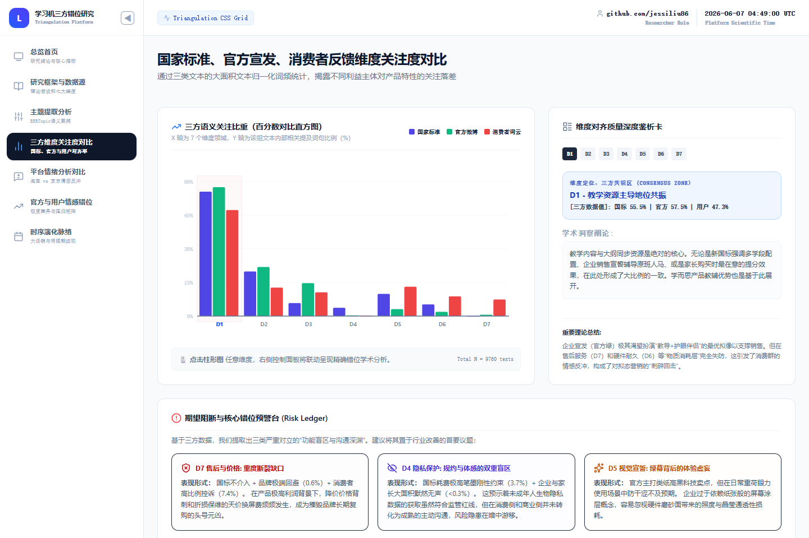

# AI Learning Device Insights

An interactive research dashboard comparing what device standards require, what brands promote, and what consumers discuss. The original Chinese interface preserves the terminology used in our computational social science course project.

## Explore the dashboard

Start with the overview, then open the stakeholder comparison to see how attention shifts across seven product dimensions. The other views cover research design, topics, platform sentiment, differences between brand and consumer sentiment, and changes over time.

[Overview](docs/screenshots/1.png) · [Research framework](docs/screenshots/2.png) · [Topic exploration](docs/screenshots/3.png) · [Platform sentiment](docs/screenshots/5.png) · [Brand and consumer sentiment](docs/screenshots/6.png) · [Timeline](docs/screenshots/7.png)

## Contributions and data

I developed the frontend, including navigation, dashboard layouts and interactive visualizations. My teammates collected the material and performed the text analysis. The interface reads prepared display values and summaries from src/data/mockData.ts. Scores, example passages and trend annotations illustrate the course presentation. Their provenance varies, so individual values should be checked against the underlying analysis before being cited.

## Local development

Use npm ci and npm run dev to open the app locally. Run npm run lint for TypeScript checks and npm run build for the production bundle. The React and TypeScript views live in src/components. Vite builds the site, Tailwind CSS styles it, and docs contains the static GitHub Pages release. The application requires no API key.

## Reuse

Contact the project owner for permission to reuse the coursework or its presentation materials.